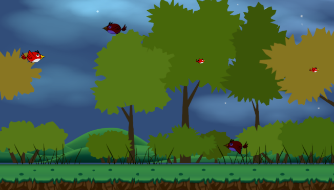

# Angry

[English](README.md)

화면 왼쪽의 빨간 새가 위아래로 움직이며 오른쪽에서 날아오는 새 떼를 차지 샷으로 맞히는 2D 슈팅 게임이다. 점수가 오를수록 적이 더 자주 나오고 플레이어의 몸집도 커지며 200점에 이르면 승리한다.




## 플레이 방법

Unity 2018.1.9f2 에서 `source/` 를 열고 `Assets/01.Scene/MainMenu.unity` 부터 실행한다. 메인 메뉴의 게임 시작 버튼을 누르면 게임이 시작된다.

원본의 그림과 소리 중 아래 에셋은 다른 사람이 만든 것으로, 공개 레포에 재배포할 수 있는지 정해지지 않아 넣지 않았다. 씬과 프리팹이 이 파일들을 참조하므로 원본과 같은 화면과 소리로 보려면 표의 경로에 넣는다.

| 에셋 | 제작자 | 넣을 경로 | 원본에서 쓰인 곳 |
|---|---|---|---|
| 그림 에셋 `2DGamesAssets` (출처 추가 확인 대상) | 추가 확인 대상 | `Assets/04.Sprite/2DGamesAssets/` | 플레이어, 적, 총알, 배경 그림과 플레이어 날갯짓 애니메이션 |
| `MainMenu.png`, `GameEnd.png`, `Button.png` (출처 추가 확인 대상) | 추가 확인 대상 | `Assets/04.Sprite/` | 메인 메뉴 배경, 게임 끝 창, 버튼 |
| 8 Bit Retro Rampage: Free Edition | Red Button Audio | `Assets/07.Sound/8BitRetroRampage/` | 발사음과 적 처치음 |
| `MainBgm.mp3`, `GameBgm.mp3` (출처 추가 확인 대상) | 추가 확인 대상 | `Assets/07.Sound/` | 메인 메뉴와 게임 씬의 배경음악 |

| 키 | 동작 |
|---|---|
| 위·아래 방향키, W·S | 위아래 이동 |
| 스페이스 | 누르고 있으면 차지바가 차고, 떼면 발사 |

모바일 빌드에서는 화면의 조이스틱으로 움직이고 발사 버튼을 눌렀다 떼서 쏜다.

차지바가 찬 만큼 총알이 커지고 끝까지 채워 쏘면 파티클과 함께 적을 뚫고 지나간다. 덜 찬 총알은 적에 맞으면 사라진다. 적을 하나 맞힐 때마다 0.5점을 얻고 적에 부딪히면 패배다.


## 구현 원리

**난도와 보상은 점수 하나로 정한다.** 적 생성 간격은 매번 `Random.Range(0.3f, 1.0f) - GameMgr.instance.score / 150` 초라서 점수가 오를수록 짧아지고 플레이어의 크기는 매 프레임 `0.5 + score / 100` 으로 다시 정해진다. 몸집이 커질수록 맞기도 쉬워지니 점수가 오르는 만큼 난도도 높아진다.

```csharp
transform.localScale = new Vector3(0.5f + (GameMgr.instance.score / 100), 0.5f + (GameMgr.instance.score / 100), 1.0f);
```

플레이어와 적의 위치는 뷰포트 좌표로 잡는다. 플레이어는 움직일 때마다 뷰포트 x 를 0.1 로, y 를 0 부터 1 사이로 고정한 뒤 월드 좌표로 되돌려 화면 밖으로 나가지 않는다. 적은 뷰포트 x 1, 임의의 y 에서 나와 왼쪽으로 힘을 받아 날아간다.


## 파일

| 경로 | 내용 |
|---|---|
| `source/Assets/01.Scene/` | 메인 메뉴와 게임 씬 |
| `source/Assets/02.Script/` | 플레이어, 총알, 적, 적 생성, 게임 관리 스크립트 |
| `source/Assets/03.Prefab/` | 플레이어, 총알, 적, 배경 프리팹 |
| `source/Assets/04.Sprite/Bar.png` | 차지바 그림 |
| `source/Assets/05.Animation/`, `06.Material/` | 플레이어 애니메이션, 적 머티리얼 |
| `source/Assets/Standard Assets/` | Unity Standard Assets 의 CrossPlatformInput |
| `source/ProjectSettings/` | Unity 2018.1.9f2 프로젝트 설정 |
| `docs/screenshots/` | 스크린샷 |


## 크레딧

- Standard Assets (CrossPlatformInput): Unity Technologies. 모바일 조이스틱과 입력 처리에 썼다.


## 라이선스

CC BY-NC-ND 4.0 라이선스다. 출처를 밝히면 비상업 용도로 그대로 공유할 수 있고, 수정본 배포와 상업적 이용은 금지한다. 함께 들어 있는 것 중 다른 사람이 만든 라이브러리와 그림·소리·맵은 각자의 권리를 따른다. 자세한 내용은 [LICENSE](LICENSE) 에 있다.
